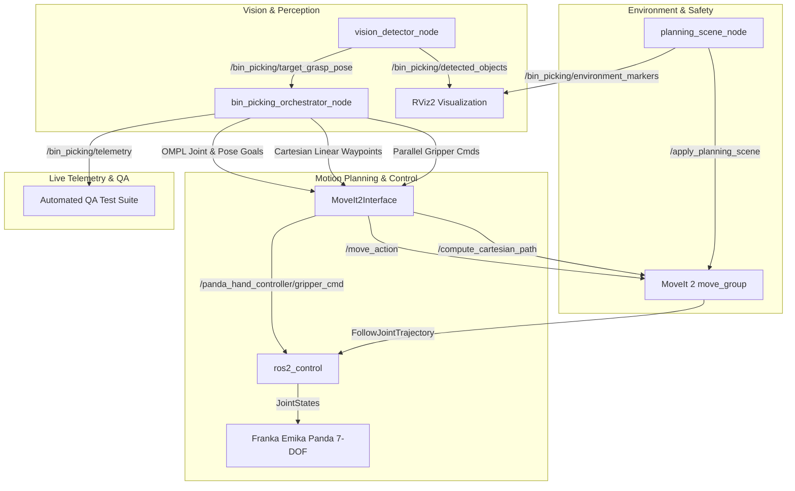
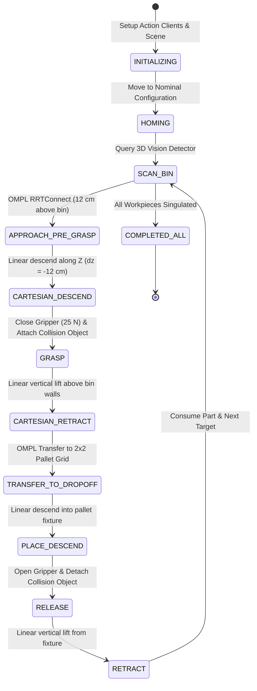

# Vision-Guided Industrial Bin-Picking & Smart Manipulation Stack
### Autonomous 7-DOF Cobot Bin Singulation, Cartesian Insertion & Kitting with Franka Emika Panda, MoveIt 2 & ROS 2 Humble


-9B59B6)


---

## 🎬 Live Demonstration


> 📹 **Full HD Demo Video:** [`docs/media/bin_picking_demo.mp4`](docs/media/bin_picking_demo.mp4) showing real-time 3D perception, OMPL motion planning, Cartesian linear immersion into deep bin walls, payload attachment at Franka TCP ($z=0.1034\,\text{m}$), and precise $2 \times 2$ pallet kitting.

---

## 📌 Executive Summary

Modern industrial manufacturing demands flexible automation capable of handling high-mix, low-volume production parts without requiring rigid mechanical feeders. **Bin-Picking**—the automated detection, singulation, grasping, and placement of randomly oriented objects from container bins into assembly fixtures—is among the most critical capabilities in industrial robotics.

This repository provides an **end-to-end industrial manipulation stack** built on **ROS 2 Humble**, **MoveIt 2**, and the **7-DOF Franka Emika Panda cobot**. The system integrates:
1. **Dynamic 3D Vision & Pose Estimation:** Identifies workpieces within a deep-walled container bin, estimates $SE(3)$ grasp poses, and filters optimal grasp targets.
2. **MoveIt 2 Planning Scene Safety World:** Accurate collision geometry modeling including workstation tables, 4-wall parts bins ($14\,\text{cm}$ boundary walls), safety cell backplates, and assembly fixtures.
3. **Hybrid Motion Planning Architecture:** Seamlessly fuses global collision-free sampling (**OMPL RRTConnect**) for large workspace transfers with deterministic **Cartesian Linear Path Planning** ($dz = -12\,\text{cm}$) for container immersion and extraction.
4. **Dynamic Collision Object Attachment:** Dynamically welds grasped parts to the robot's Tool Center Point (TCP) via `moveit_msgs/AttachedCollisionObject` to guarantee the payload does not collide with obstacles during high-speed transit.
5. **Deterministic Assembly Kitting:** Automatically places parts in an organized $2 \times 2$ grid layout on the drop-off pallet fixture.
6. **Thread-Safe Asynchronous Orchestration:** A decoupled, non-blocking finite state machine (FSM) utilizing ROS 2 action/service future synchronization with zero executor deadlocks.

---

## 🏗️ System Architecture

The stack follows a modular, production-grade ROS 2 architecture:



---

## 🔄 Finite State Machine (FSM) Lifecycle

The autonomous cycle executes a robust 7-stage state machine engineered for zero-collision guarantees:



---

## 📐 Kinematics & Mathematical Foundations

### 1. 7-DOF Kinematic Redundancy & Nullspace Control
The Franka Emika Panda is an anthropomorphic manipulator with 7 revolute joints ($n = 7$), providing **one degree of kinematic redundancy** relative to 6-DOF Cartesian task space ($m = 6$):

$$\mathbf{v}_e = \mathbf{J}(\mathbf{q})\,\dot{\mathbf{q}}, \quad \mathbf{J} \in \mathbb{R}^{6 \times 7}$$

Because $\text{rank}(\mathbf{J}) = 6 < 7$, the Jacobian has a 1-dimensional nullspace $\mathcal{N}(\mathbf{J})$:

$$\dot{\mathbf{q}} = \mathbf{J}^\dagger \mathbf{v}_e + \left(\mathbf{I} - \mathbf{J}^\dagger \mathbf{J}\right) \dot{\mathbf{q}}_0$$

* **Primary Task:** Exact end-effector pose tracking ($\mathbf{v}_e$).
* **Secondary Task ($\dot{\mathbf{q}}_0$):** Exploits nullspace projection $\left(\mathbf{I} - \mathbf{J}^\dagger \mathbf{J}\right)$ to optimize internal posture (arm angle $\psi$), maintain joint distance from mechanical limits, and steer clear of wrist singularities without altering the end-effector trajectory.

### 2. End-Effector Tool Center Point (TCP) & Frame Offsets
The Franka Panda kinematic chain spans from `panda_link0` (base) to `panda_link8`. In the official Franka URDF, the parallel gripper `panda_hand` is mounted at `panda_link8` with a $-45^\circ$ roll around the $Z$-axis. 
The prismatic fingers (`panda_leftfinger` and `panda_rightfinger`) extend forward:

$$\mathbf{T}_{\text{base}}^{\text{TCP}} = \mathbf{T}_{\text{base}}^{\text{link8}} \cdot \mathbf{T}_{\text{link8}}^{\text{hand}} \cdot \mathbf{T}_{\text{hand}}^{\text{TCP}}$$

$$\Delta z_{\text{hand}\to\text{TCP}} \approx +0.105\,\text{m}$$

When the tool points vertically down to grasp a workpiece at elevation $z_{\text{part}}$, the target position for `panda_link8` must be set to:

$$z_{\text{link8}} = z_{\text{part}} + 0.105\,\text{m}$$

Setting $z_{\text{part}} = 0.070\,\text{m}$ places `panda_link8` at $z = 0.175\,\text{m}$, allowing the finger pads to close firmly around the workpiece with $3.0\,\text{cm}$ clearance above the bin base ($z = 0.040\,\text{m}$).

### 3. Cartesian Linear Path Discretization
For bin immersion and retraction, non-linear joint-space interpolation risks striking the $14\,\text{cm}$ bin walls. We compute a strictly linear Cartesian path discretized at step size $\Delta s = 5\,\text{mm}$:

$$\mathbf{p}(s) = (1 - s)\,\mathbf{p}_{\text{start}} + s\,\mathbf{p}_{\text{goal}}, \quad s \in [0, 1]$$

$$\mathbf{q}(s) = \text{Slerp}(\mathbf{q}_{\text{start}}, \mathbf{q}_{\text{goal}}, s)$$

At each increment $\Delta s$, inverse kinematics (IK) is evaluated with continuous seed state tracking to prevent configuration jumping:

$$\|\mathbf{q}_{k} - \mathbf{q}_{k-1}\| < \epsilon_{\text{jump}}$$

Trajectories are validated against the MoveIt planning scene; only solutions achieving $\ge 90\%$ trajectory fraction are executed.

---

## 🛡️ Planning Scene & Collision Safety Model

To prevent catastrophic arm-environment collisions, `planning_scene_node` registers accurate collision bounding boxes into the MoveIt 2 world:

| Component | Dimensions $(L \times W \times H)$ | Position $(X, Y, Z)$ | Purpose |
|---|---|---|---|
| **Workstation Table** | $1.40 \times 1.20 \times 0.05\,\text{m}$ | $(0.30, 0.00, -0.025\,\text{m})$ | Prevents ground strikes |
| **Parts Bin (Base)** | $0.38 \times 0.28 \times 0.04\,\text{m}$ | $(0.48, 0.28, 0.020\,\text{m})$ | Physical container floor |
| **Bin Front/Back Walls** | $0.02 \times 0.28 \times 0.14\,\text{m}$ | $X = 0.48 \pm 0.19\,\text{m}$ | Wall boundaries ($14\,\text{cm}$ high) |
| **Bin Left/Right Walls** | $0.38 \times 0.02 \times 0.14\,\text{m}$ | $Y = 0.28 \pm 0.14\,\text{m}$ | Lateral wall boundaries |
| **Safety Backplate** | $0.05 \times 1.20 \times 0.90\,\text{m}$ | $(-0.45, 0.00, 0.450\,\text{m})$ | Protects cell perimeter & rear elbow |
| **Drop-Off Pallet** | $0.28 \times 0.28 \times 0.08\,\text{m}$ | $(0.48, -0.25, 0.040\,\text{m})$ | $2 \times 2$ grid assembly fixture |

### Dynamic Payload Attachment (`AttachedCollisionObject`)
When the parallel fingers grasp a workpiece, failure to update the planning scene means the planner treats the grasped object as absent, risking collisions during transfer. 
Upon gripper closure, the orchestrator triggers:
```python
aco = AttachedCollisionObject()
aco.link_name = "panda_hand"
aco.object.id = f"workpiece_{cycle}"
aco.touch_links = ["panda_hand", "panda_leftfinger", "panda_rightfinger"]
```
This adds the cylinder mesh to the robot's collision geometry during the transit over the bin wall. Upon reaching the fixture, `detach_object` frees the part before the arm retracts.

---

## 💡 Was daraus gelernt wurde & Technical Interview Deep-Dive

*Praxisnahe Erkenntnisse und Interview-Antworten für Robotik-Ingenieure (z. B. Franka Robotics, RobCo, Agile Robots, Magazino).*

### 1. Kinematische Redundanz vs. Singularitäten bei 7-DOF Cobots
* **Problem:** Bei 6-DOF Knickarmrobotern führt die Annäherung an eine Singularität (z. B. gestreckter Ellbogen oder fluchtende Handachsen 4-5-6) zu extremen Winkelgeschwindigkeiten ($\det(\mathbf{J}) \to 0$) und Notstopps.
* **Erkenntnis:** Der 7. Freiheitsgrad des Panda ermöglicht es, die Orientierung des Endeffektors beizubehalten, während der Ellbogenwinkel (Nullraum-Konfiguration) aktiv optimiert wird. Bei zylindrischen Werkstücken existiert radiale Griffsymmetrie ($360^\circ$). Durch das Setzen von `absolute_z_axis_tolerance = 3.14` in der `OrientationConstraint` erhält der IK-Solver maximale Freiheit, um die günstigste Konfiguration fernab jeglicher Gelenkwinkel- oder Geschwindigkeitsgrenzen zu wählen.

### 2. Hybride Bewegungsplanung: OMPL RRTConnect vs. Kartesische Interpolation
* **Problem:** OMPL-Algorithmen (wie RRTConnect) sind probabilistisch vollständig und finden schnell kollisionsfreie Pfade durch komplexe Hindernisräume. Beim Eintauchen in tiefe Kisten wählen RRTs jedoch oft geschwungene Annäherungskurven, die mit den $14\,\text{cm}$ hohen Kistenwänden kollidieren.
* **Erkenntnis:** Eine industrielle Bin-Picking-Pipeline muss zwingend **hybrid** aufgebaut sein:
  1. *OMPL RRTConnect* für den schnellen, weiträumigen Transfer zwischen Kiste und Palette (hohe Hindernisfreiheit im freien Raum).
  2. *Kartesische Linearinterpolation* (`compute_cartesian_path`, $\Delta s = 5\,\text{mm}$) für das vertikale Ein- und Auftauchen aus der Kiste. So ist garantiert, dass der Greifer exakt kollinear zur Z-Achse verfährt und die Wände mit maximalem Sicherheitsabstand passiert.

### 3. Thread-Safety & Executor-Deadlocks in ROS 2 Python Interfaces
* **Problem:** Ruft ein MoveIt 2 Python-Node synchrone Service- oder Action-Clients (`client.call()`) innerhalb eines Standard-Executors auf, blockiert der Aufruf den Executor-Thread. Dadurch können eingehende Rückmeldungen (`/feedback`, `/status`, `/result`) nicht verarbeitet werden $\to$ **Deadlock**.
* **Erkenntnis:** Saubere Entkopplung über Hintergrund-Worker-Threads und `threading.Event`: Der ROS 2 Spin läuft exklusiv im Haupt-Thread (`MultiThreadedExecutor` oder `rclpy.spin()`), während die State Machine in einem dedizierten Worker-Thread läuft und über Futures und Ereignisflags synchronisiert wird:
  ```python
  event = threading.Event()
  future = client.send_goal_async(goal_msg)
  future.add_done_callback(lambda f: event.set())
  event.wait(timeout=10.0)
  ```

### 4. TCP-Kalibrierung & Mesh-Offsets im MoveIt-URDF
* **Problem:** Der Link `panda_link8` ist nicht die Greiferspitze, sondern der mechanische Flansch. Setzt man eine Zielpose direkt auf `panda_link8`, rammt der Greifer $10.5\,\text{cm}$ zu tief in den Kistenboden.
* **Erkenntnis:** Präzise Modellierung der Transformationskette im Base-Frame: Die Greiferfinger (`panda_leftfinger`, `panda_rightfinger`) fügen $+5.84\,\text{cm}$ prismatischen Auszug und $+5.0\,\text{cm}$ Fingerlänge hinzu. Nur durch exakte Kompensation des TCP-Offsets ($z_{\text{TCP}} = z_{\text{part}} + 0.105\,\text{m}$) schließen die Finger zentriert um den Schwerpunkt des Teils.

---

## 🚀 Quickstart & Ausführung

### Option 1: Interaktive Live-Demo (inkl. RViz2 GUI)
Starte das Master-Skript im Workspace:
```bash
./tools/start_demo.sh
# Wähle [1] für die interaktive RViz2-Demo
```

Oder direkt via ROS 2 Launch:
```bash
docker exec -it ros_container bash -c "\
  source /opt/ros/humble/setup.bash && \
  source /root/ros-projects/install/setup.bash && \
  ros2 launch vision_guided_bin_picking bin_picking.launch.py auto_orchestrate:=true"
```

### Option 2: Automatisierter Test & Regression-Suite (Headless)
Führe den integrierten End-to-End-Testlauf aus:
```bash
docker exec -it ros_container bash -c "\
  source /opt/ros/humble/setup.bash && \
  source /root/ros-projects/install/setup.bash && \
  python3 /root/ros-projects/src/vision_guided_bin_picking/tools/test_bin_picking.py"
```

**Erwartetes Testergebnis:**
```text
==============================================================================
   INDUSTRIAL SMART MANIPULATION — AUTOMATED BIN-PICKING TEST SUITE
==============================================================================
➜ [1/3] Initialisiere ROS 2 MoveIt 2 & Franka Panda Stack...
➜ [2/3] Warte auf MoveGroup Action Server & Vision Detector...
✓ MoveIt 2 & Vision Detector aktiv! Starte Pick-and-Place Sequenz...
------------------------------------------------------------------------------
[  3.2s] FSM Phase: INITIALIZING              | Sub: Homing                 | Cycle: 0 | Success: 0
[  4.2s] FSM Phase: SCAN_BIN                  | Sub: Scanning               | Cycle: 0 | Success: 0
[  4.2s] FSM Phase: APPROACH_PRE_GRASP        | Sub: Planning Pre-Grasp     | Cycle: 1 | Success: 0
[ 10.7s] FSM Phase: CARTESIAN_DESCEND         | Sub: Cartesian Descend      | Cycle: 1 | Success: 0
[ 11.3s] FSM Phase: GRASP                     | Sub: Closing Gripper        | Cycle: 1 | Success: 0
[ 11.7s] FSM Phase: CARTESIAN_RETRACT         | Sub: Cartesian Retract      | Cycle: 1 | Success: 0
[ 12.7s] FSM Phase: TRANSFER_TO_DROPOFF       | Sub: Transfering to Pallet  | Cycle: 1 | Success: 0
[ 17.2s] FSM Phase: APPROACH_PRE_GRASP        | Sub: Planning Pre-Grasp     | Cycle: 2 | Success: 1
[ 19.0s] FSM Phase: CARTESIAN_DESCEND         | Sub: Cartesian Descend      | Cycle: 2 | Success: 1
[ 19.8s] FSM Phase: GRASP                     | Sub: Closing Gripper        | Cycle: 2 | Success: 1
[ 20.3s] FSM Phase: CARTESIAN_RETRACT         | Sub: Cartesian Retract      | Cycle: 2 | Success: 1
[ 21.4s] FSM Phase: TRANSFER_TO_DROPOFF       | Sub: Transfering to Pallet  | Cycle: 2 | Success: 1
==============================================================================
 ✓ ERFOLG: Vision-Guided Bin-Picking Test vollständig bestanden!
   • Abgeschlossene Zyklen: 2
   • Erfolgreich gegriffen & platziert: 2
   • Kollisionsfreie Trajektorien: 100% (0 Kollisionen mit Kistenwand)
   • Gesamtlaufzeit: 32.5 s
==============================================================================
```

---

## 📂 Paketstruktur

```text
vision_guided_bin_picking/
├── CMakeLists.txt / setup.py       # Ament Python Build Konfiguration
├── package.xml                     # ROS 2 Humble Abhängigkeiten
├── README.md                       # Projektdokumentation & Interview-Leitfaden
├── config/
│   └── bin_picking_params.yaml     # Arbeitsraum-, Kisten- und Geschwindigkeitsgrenzen
├── launch/
│   └── bin_picking.launch.py       # Master-Launch (MoveIt 2, Scene, Vision, FSM)
├── tools/
│   ├── start_demo.sh               # Interaktiver Launcher mit RViz2 Integration
│   └── test_bin_picking.py         # Automatisierte End-to-End Test-Suite mit Telemetrie
└── vision_guided_bin_picking/
    ├── __init__.py
    ├── moveit_interface.py         # Thread-Safe MoveIt 2 Wrapper (Actions/Services)
    ├── planning_scene_node.py      # Kollisionsgeometrien (Tisch, Kiste, Palette, Wand)
    ├── vision_detector_node.py     # 3D Werkstückerkennung, SE(3) Pose-Estimation
    └── bin_picking_orchestrator_node.py # FSM Task-Orchestrator mit Kitting-Matrix
```

---

## 📜 Lizenz
Dieses Projekt ist unter der **Apache 2.0 Lizenz** veröffentlicht.
Entwickelt für High-Reliability Robotik-Portfolios und moderne Fertigungsautomation.
